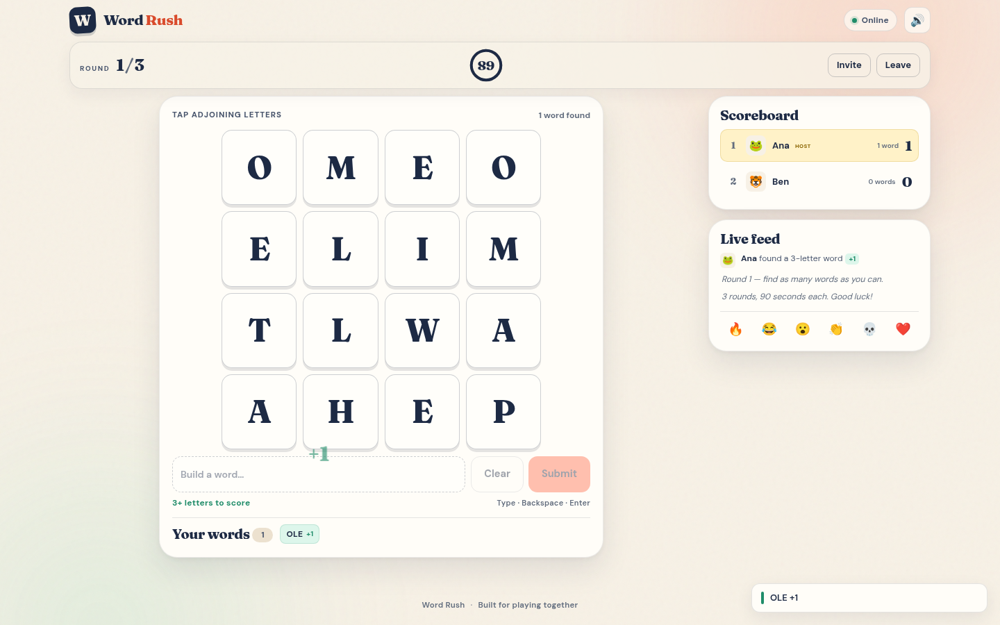

# Word Rush

A real-time multiplayer word hunt for friends, family, and classmates. Everyone opens the same 4×4 board, races the same countdown, and tries to outscore the room. No accounts, downloads, or app installs.

**Play:** https://play.abhi2.me

Create a room, share the code or link, and play from any phone or laptop.



## Run it locally

Requires Node.js 20 or newer.

```bash
npm ci
npm start
```

Open <http://localhost:3000>. Create a room, then open the invite link on a second device or browser profile to play together.

## How to play

- Three rounds, 90 seconds each by default. The host can choose 3 or 5 rounds and 60, 90, or 120 seconds.
- Tap neighboring letters in any direction, including diagonals. Each tile can be used once per word.
- Words must be 3–12 letters and appear in the game’s word list.
- Points by length: 3 letters = 1, 4 = 2, 5 = 3, 6 = 5, 7 = 8, 8+ = 12.
- Every player gets the same board. Other players’ words stay hidden until the round ends.
- After the final round, the host can start a rematch with the same room.

## What is included

- Room codes and shareable invite links
- Live scoreboard, activity feed, emoji reactions, and round results
- Server-authoritative game state and synchronized countdowns
- Automatic reconnect and session restoration after a refresh
- Host controls, host transfer, late joining, and rematches
- Mobile-first layout, keyboard input on desktop, sound effects, and confetti
- QR code for joining from a phone

## Project layout

```text
server.js              HTTP + WebSocket entry point
src/app.js             Express app, static hosting, QR endpoint, WebSocket wiring
src/game.js            Dictionary, board generation, word and path validation
src/rooms.js           Rooms, players, rounds, timers, reconnection, scoring
public/index.html      Screens and UI shell
public/styles.css      Responsive visual design
public/app.js          Browser state, WebSocket client, rendering, input, audio
data/words.txt         Curated dictionary
data/blocked.txt       Name and word screening list
test/game.test.js      Unit tests for the game engine
test/integration.test.js  Two-player WebSocket integration test
scripts/playtest.mjs   Headless browser flow with screenshots
```

## Tests

```bash
npm test
```

The integration test starts a server on an ephemeral port and verifies room creation, joining, synchronized boards, claiming a word, results, next-round flow, host transfer, and reconnection.

The browser flow additionally verifies the real UI, including a phone-sized join, and writes screenshots to `test-artifacts/`:

```bash
npm run test:ui
```

It uses `playwright-core` with an installed Chrome/Chromium and does not download a browser. Set `CHROME_PATH` if Chrome is not at `/usr/bin/google-chrome`:

```bash
CHROME_PATH=/path/to/chrome npm run test:ui
```

## Deploy it

See [DEPLOY.md](DEPLOY.md) for Render, Docker, VPS, and temporary tunnel instructions, including DNS records for GoDaddy and Namecheap.

The server keeps rooms in memory and must run as a single instance. If you need horizontal scaling, move room state to a shared store and add a pub/sub layer for WebSocket messages.

## Word list and credits

See [NOTICE.md](NOTICE.md). The app has no runtime API keys or external services.

## License

Code is MIT licensed. See [LICENSE](LICENSE).
